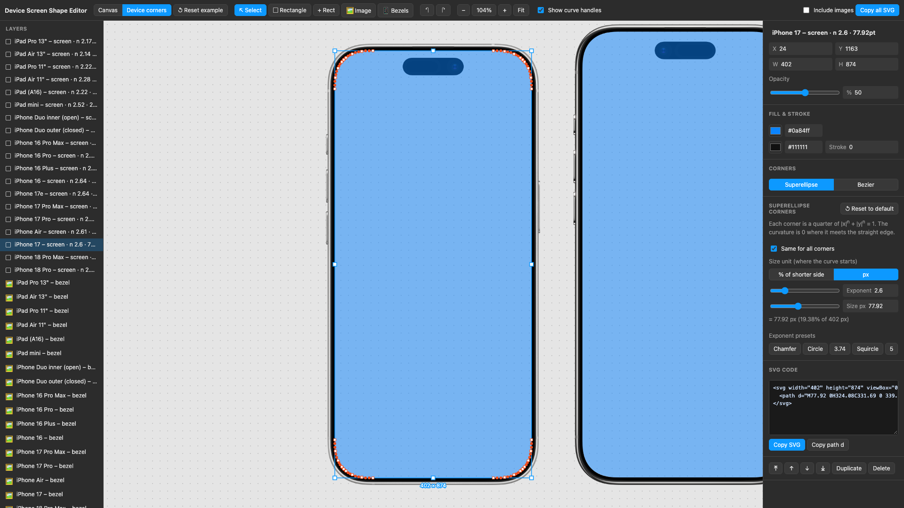
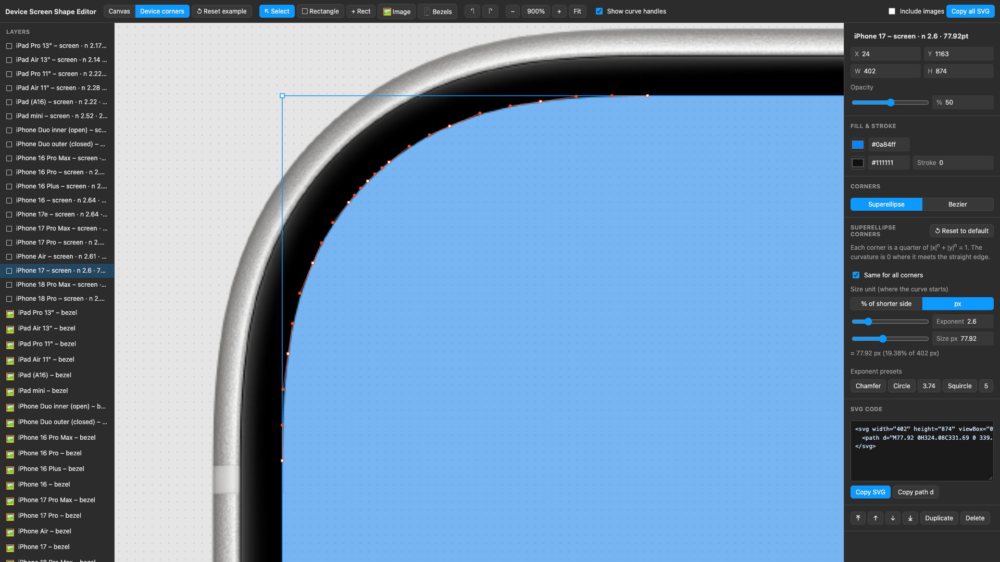

# Device Screen Shape Editor

A small local web app to draw rectangles with smooth corners, match them to device screens, and copy the result as SVG.



Close-up of the top-left corner at 900%. The superellipse is drawn as cubic segments; the red points and lines are their anchors and handles, on top of the bezel PNG.



## Features

- **Rectangles with two corner types**
  - **Superellipse** (default): each corner is a quarter of `|x|^n + |y|^n = 1`. Set the exponent `n` and the size (px, or % of the shorter side). The curvature is 0 where the corner meets the straight edge.
  - **Bezier**: one cubic bezier for each corner, with a radius and a tension (0.5523 = circle).
  - Both types can use the same values for all corners, or different values for each corner.
- **Images**: drop, paste, or pick images. Move and resize them, and change their opacity.
- **SVG export**: copy the SVG or the path `d` of the selected rectangle, or the SVG of all shapes.
- **Device corners page** (`#device-corners`): one entry for each unique screen shape, named after the oldest device with that screen. Each entry is an Apple device bezel with a screen rectangle on top. The corners are superellipses fitted to the screen opening in the bezel PNG.
- Undo and redo, zoom and pan, and autosave to the browser's localStorage. Each page has its own saved data.

## Run

```sh
npm install
npm run dev -- --host --port 5199
```

## Files

- `src/geometry.ts`: corner math. Builds the SVG path for both corner types. A superellipse corner is drawn as 8 cubic segments, within 0.15% of the exact curve.
- `src/deviceCorners.ts`: measured screen positions, sizes, and corner values for the Device corners page.
- `src/bezels.ts`: the default bezels on the main canvas.
- `src/snippets/screenSquircleMask.ts`: a standalone CSS-mask snippet. `SCREEN_SHAPES` has the 20 unique screen shapes (the same as the Device corners page), and `DEVICE_SCREEN_SHAPES` maps 61 devices to them.
- `public/bezels/`: bezel PNGs.

## Measured device corners

The values in `src/deviceCorners.ts` come from the screen openings in the bezel PNGs. For each device, one superellipse is fitted to the edge points of all four screen corners. The iPhone Duo outer screen has one value for the left corners and one for the right corners. In every corner, the fitted curve is less than 0.7 PNG px from the PNG edge.

The Device corners page shows 20 unique screen shapes. A screen shape is one screen size with one corner shape. Devices share an entry when the Xcode simulator device types give them the same screen, or when their measured corners are the same within the measurement accuracy. Each entry has the name of the oldest device with that screen. The layer names list the other devices with the same screen, and the bezel layer names say which device's PNG was measured, for example "iPhone 14 Pro – bezel (iPhone 16 PNG)".

Notes:

- The iPhone 11–14 bezels are no longer linked from Apple's page, but they are still on Apple's download server (`Bezel-iPhone-11.dmg` … `Bezel-iPhone-14.dmg`).
- The iPad Pro 11" (1st–4th gen) bezel was removed from Apple's server. It comes from the Internet Archive copy of `Bezel-iPad-Pro.dmg` (2024-03-03).
- Apple drew the iPhone 12 mini screen at 1125 × 2436 px (375 × 812 pt), but the device is 1080 × 2340 px (360 × 780 pt). The example scales that bezel by 1125 / 360 = 3.125 px per pt.
- The iPhone 12 and 13 families are merged (12 / 12 Pro with 13 / 13 Pro / 14, 12 Pro Max with 13 Pro Max / 14 Plus, 12 mini with 13 mini). Their simulator masks differ slightly, but their measured corners are at most 0.19 pt apart. Each merged corner is fitted to an iPhone 12 bezel and a newer bezel together.
- The iPhone 17e has no bezel PNG. It has the same screen as the iPhone 13 and 14 (2532 × 1170 px), so it is part of the "iPhone 12" entry.

## Bezel images

The bezel PNGs come from [Apple Design Resources](https://developer.apple.com/design/resources/) and are subject to Apple's license terms.
